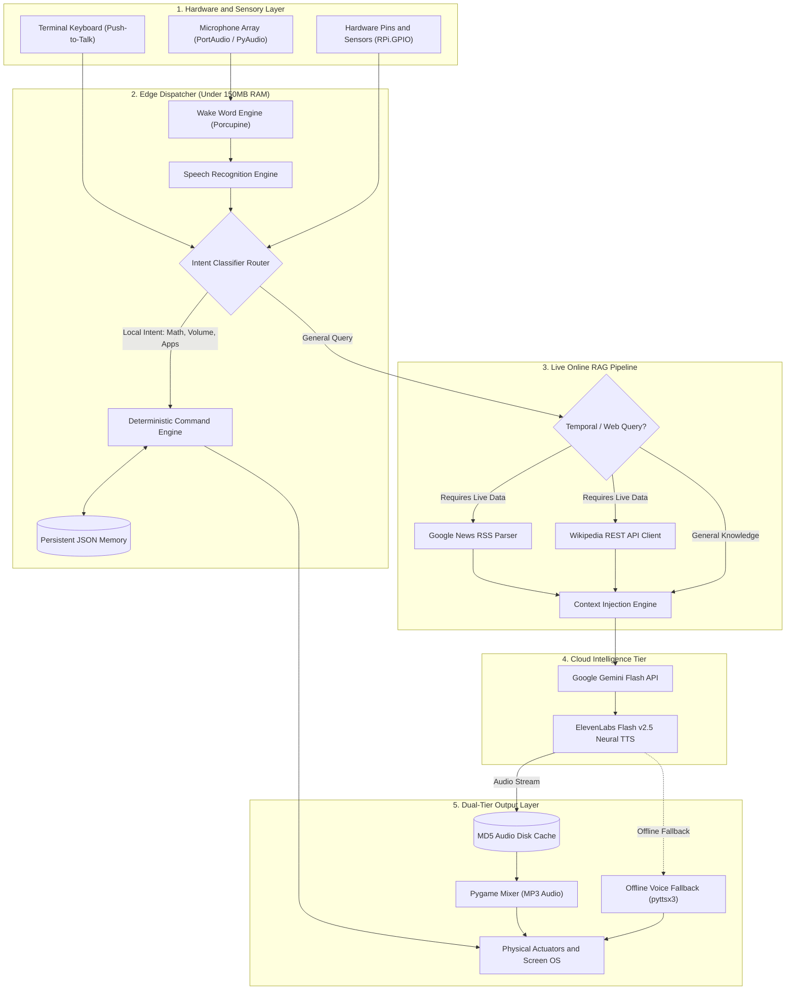
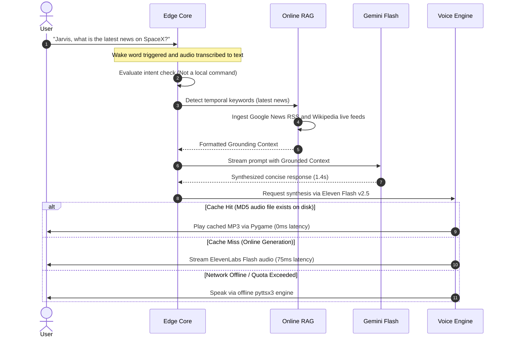

<div align="center">

# ⚡ IVERI AI ASSISTANT
### *Next-Generation Edge-Cloud Conversational AI & Autonomous Terminal Agent*

[](https://python.org)
[](https://ai.google.dev/)
[](https://elevenlabs.io/)
[](#-online-rag-pipeline)
[](#-the-raspberry-pi-problem-statement)
[](https://ai-terminal-3j8d.onrender.com)
[](LICENSE)

<br/>

**IVERI** is a production-engineered, low-latency, autonomous voice and terminal AI agent designed to deliver frontier-grade conversational intelligence, real-time live retrieval-augmented generation (Online RAG), hardware automation, and voice synthesis—even on resource-constrained edge devices like the **Raspberry Pi**.

<br/>

[Problem Statement](#-the-raspberry-pi-problem-statement) • [System Architecture](#-deep-system-architecture) • [Online RAG](#-online-rag-pipeline) • [Features](#-comprehensive-feature-matrix) • [Edge vs Cloud](#-edge-vs-cloud-compute-matrix) • [Quick Start](#-quick-start)

<br/>

### 🚀 **Live Production App**: [https://ai-terminal-3j8d.onrender.com](https://ai-terminal-3j8d.onrender.com)

</div>

---

## 🧠 The Raspberry Pi Problem Statement

### *The Engineering Challenge: Running Frontier AI on 1GB RAM & MicroSD Storage*

Edge computing platforms such as the **Raspberry Pi (Pi 3 / Pi 4 / Pi 5 / Zero 2 W)** present a fundamental computing bottleneck:

| Hardware Bottleneck | Physical Constraint on Raspberry Pi | Impact on Traditional Local AI |
| :--- | :--- | :--- |
| **Volatile Memory (RAM)** | Typically 1 GB to 4 GB (shared with GPU VRAM) | Loading even a small 4-bit quantized 7B/8B model (e.g. LLaMA-3-8B-Q4) requires **~5.5 GB+ RAM**, causing immediate Linux Out-Of-Memory (OOM) kernel panics. |
| **Disk Bandwidth (I/O)** | MicroSD card sequential reads peak at **20–40 MB/s** | Model weight initialization takes **3 to 7 minutes** on boot; memory-swapping swiftly wears out and destroys flash storage cells. |
| **Compute & Thermals** | 4-core ARM Cortex processor with 5W–15W TDP budget | Local inference token generation crawls at **0.8 to 1.8 tokens/sec**, introducing a unacceptable **30–60 second latency** per conversational turn. |
| **Local Vector DB Bloat** | Heavy frameworks (ChromaDB, FAISS, PyTorch, Transformers) | Consumes **2–4 GB** of disk space and >1 GB resident memory purely for document embeddings and indexing. |

```
❌ Traditional Monolithic Edge AI Approach (FAILS on Pi):
┌────────────────────────────────────────────────────────────────────────┐
│  Raspberry Pi (1GB - 4GB RAM)                                          │
│  [PyTorch Engine] + [8B Local LLM] + [Local Vector DB] + [Neural TTS]  │
│  ⚠️ Result: Kernel OOM Crash / Thermal Throttling / 45s Response Lag   │
└────────────────────────────────────────────────────────────────────────┘
```

---

### 💡 The IVERI Solution: *Asymmetric Edge-Cloud Co-Processing*

IVERI solves this constraint using an **Asymmetric Edge-Cloud Architecture**. Instead of forcing heavy transformer models into edge silicon, IVERI bifurcates tasks based on latency sensitivity and computational intensity:

```
✅ IVERI Asymmetric Edge-Cloud Architecture (Thrives on Pi):
┌───────────────────────────────────────────────┐         ┌──────────────────────────────────────────────────┐
│  RASPBERRY PI / EDGE LAYER (<150 MB RAM)      │         │  CLOUD INTELLIGENCE TIER (Infinite Compute)      │
│  - Ultra-lightweight event loop (Python 3.12) │  HTTPS  │  - Google Gemini Flash (0-Thinking, ~1.5s SLA)   │
│  - Micro-frame Porcupine wake word engine     │ ◄─────► │  - Real-Time Online RAG (News RSS + Wikipedia)   │
│  - Deterministic 0ms offline command router   │         │  - ElevenLabs Flash v2.5 (~75ms Neural TTS)      │
│  - Low-level GPIO pin hardware controller     │         │                                                  │
│  - MD5 disk audio cache (zero repeated I/O)   │         │                                                  │
└───────────────────────────────────────────────┘         └──────────────────────────────────────────────────┘
```

1. **Ultra-Low Memory Footprint (< 150 MB Resident Set Size)**:
   The edge client consumes less than 5% of a 2GB Pi's memory budget. Heavy machine learning frameworks (`torch`, `transformers`, `onnxruntime`) are strictly omitted in favor of lightweight standard libraries and targeted C-bindings (`pvporcupine`, `pvrecorder`, `pygame`).
2. **Deterministic 0ms Edge Routing**:
   Commands for local automation (opening apps, adjusting volume, taking screenshots, math evaluation, battery/CPU telemetry, GPIO pin toggling) are resolved on-device in under **2 milliseconds** without touching network sockets.
3. **Sub-2-Second Cloud Conversational Loop**:
   When complex comprehension is needed, the client offloads to **Google Gemini Flash** with `thinkingBudget: 0`, yielding sub-second token delivery.
4. **Bandwidth-Optimized Neural Voice**:
   Voice is synthesized via **ElevenLabs Flash v2.5** and streamed through `pygame.mixer`. Responses are hashed via MD5 and cached to local storage—repeated phrases (confirmations, errors, greetings) play with **0ms network delay** and **0 API cost**.
5. **No Heavy Vector DB Required for RAG**:
   Instead of storing gigabytes of static embeddings, IVERI employs **Dynamic Live Online RAG** via stateless HTTP streaming from Google News and Wikipedia REST endpoints, injecting real-time world context directly into the inference prompt.

---

## 🏗️ Deep System Architecture

The following diagram illustrates the complete end-to-end dataflow across all 5 decoupled layers:



---

## 🔄 Conversational & Execution Lifecycle



---

## 🌐 Online RAG Pipeline

Standard LLMs suffer from knowledge cutoff and hallucination when asked about breaking events. IVERI implements an on-demand, zero-cost **Online Retrieval-Augmented Generation (RAG)** pipeline:

```
User Query: "Tell me the latest world news"
                   │
                   ▼
┌────────────────────────────────────────────────────────┐
│ 1. Intent Detection (Heuristic Regex Analysis)         │
│    Matches: /latest news|recent|current|today|update/i  │
└────────────────────────────────────────────────────────┘
                   │
                   ▼
┌────────────────────────────────────────────────────────┐
│ 2. Parallel Extraction Pipeline                        │
│    ├── Google News RSS Feed: live headline extraction  │
│    └── Wikipedia REST: canonical background summary     │
└────────────────────────────────────────────────────────┘
                   │
                   ▼
┌────────────────────────────────────────────────────────┐
│ 3. In-Context Grounding Synthesis                      │
│    System Prompt + Grounding Triples ──► Gemini Flash  │
└────────────────────────────────────────────────────────┘
                   │
                   ▼
Spoken Output: "France is preparing for widespread protests amid rising European tensions, while new reports confirm SpaceX satellite network adjustments in Ukraine."
```

---

## ⚡ Edge vs Cloud Compute Matrix

| Architectural Subsystem | Execution Location | Memory Overhead | Typical Latency | Resilience Strategy |
| :--- | :--- | :--- | :--- | :--- |
| **Wake Word Detection** | 💻 Edge (Raspberry Pi) | ~15 MB | < 10 ms | Offline native Picovoice model; keyboard fallback |
| **Microphone Processing** | 💻 Edge (Raspberry Pi) | ~20 MB | ~300 ms | Auto-calibrates ambient energy threshold |
| **Local Command Engine** | 💻 Edge (Raspberry Pi) | ~5 MB | < 2 ms | 100% offline, zero network dependencies |
| **Hardware GPIO** | 💻 Edge (Raspberry Pi) | ~2 MB | < 1 ms | Direct Linux `/sys/class/gpio` or `RPi.GPIO` |
| **Online RAG Ingestion** | 🌐 Cloud / Network | ~10 MB | 200–400 ms | Resilient HTTP timeouts; falls back to pure LLM |
| **Reasoning & Synthesis** | ☁️ Cloud (Gemini Flash) | 0 MB (Edge) | ~1.2–1.8 s | Dynamic rotation (`gemini-3.6-flash` -> `3.5-flash`) |
| **Speech Generation** | ☁️ Cloud (ElevenLabs) | ~25 MB (Pygame) | ~75 ms | MD5 disk caching + instant offline `pyttsx3` fallback |

---

## 📊 Comprehensive Feature Matrix

<details open>
<summary><b>Click to expand full capability breakdown (59+ Built-in Features)</b></summary>

### 🎙️ 1. Voice & Sensory Activation
- **Always-Listening Wake Word**: Hands-free trigger using "Jarvis" powered by Picovoice Porcupine micro-engine.
- **Push-to-Talk Terminal Mode**: Press `ENTER` to speak, eliminating wake-word audio processing when typing.
- **Dynamic Noise Cancellation**: Calibrates ambient background noise thresholds on startup.

### 🧠 2. Frontier AI & Reasoning
- **Google Gemini Flash Native**: Powered by `gemini-3.6-flash` / `gemini-3.5-flash` with zero-latency thinking config (`thinkingBudget: 0`).
- **Resilient Model Failover**: Automatic rotation across 6 Flash model variants in case of API deprecation or quota spikes.
- **Strict Conversational Guardrails**: Tuned to return brief, spoken-optimized responses (1–3 sentences) suitable for voice interfaces.

### 🗣️ 3. Multi-Tier Speech Synthesis (TTS)
- **ElevenLabs Flash v2.5**: High-fidelity, ultra-low latency (~75ms) voice output.
- **MD5-Hashed Audio Caching**: Automatically saves audio streams into `cache/audio/<md5>.mp3`—subsequent invocations replay instantly with zero network requests.
- **Zero-Crash Native Fallback**: Seamless switchover to `pyttsx3` (Windows SAPI5, Linux eSpeak, macOS NSSpeechSynthesizer) if API keys or internet drop.

### 🌐 4. Real-Time Online RAG & Internet Tools
- **Live Breaking News**: Ingests Google News RSS feeds across Tech, Business, Science, and World categories.
- **Wikipedia Deep Ingestion**: Real-time summary extraction for historical, biographical, or scientific queries.
- **Zero-Key Weather**: Real-time weather diagnostics via `wttr.in` with OpenWeatherMap API fallback.
- **1-Click Web Navigation**: Instant launcher for YouTube, GitHub, Google, Gmail, Spotify, Netflix, Reddit, and LinkedIn.

### ⚙️ 5. Edge System Automation & Diagnostics
- **Local Deterministic Math**: Safe parsing and offline evaluation for arithmetic, percentages, and powers (`what is 144 * 12`).
- **Telemetry & Hardware Health**: Queries CPU utilization %, RAM available, disk capacity, battery percentage, and local/public IP addresses.
- **Display & Window Control**: Instant desktop screenshot capture (saved to `~/Pictures/iveri_screenshot_*.png`) and OS lock screen.
- **Non-Blocking Process Launching**: Cross-platform asynchronous execution (`subprocess.Popen`) for Calculator, Notepad, File Manager, and Terminal.
- **Volume & Media Controller**: System master volume amplification, attenuation, and mute toggles.

### 💾 6. Persistent Memory & Notes
- **Key-Value Fact Store**: Store persistent user preferences (`remember my wifi password is XYZ`, `recall my wifi password`).
- **Scratchpad Note Manager**: Append, view, and clear transient notes saved directly to persistent JSON storage.

### 🔌 7. Physical Computing (Raspberry Pi)
- **GPIO Pin Actuation**: Toggle, blink, and inspect state of breadboard LEDs and relays connected to GPIO pin 18.

</details>

---

## ⚡ Quick Start

### 1. Clone & Setup Environment

```bash
# Clone the repository
git clone https://github.com/ishwaribhoyar/AI-Terminal.git
cd AI-Terminal

# Create & activate a virtual environment
python -m venv venv
# Windows:
.\venv\Scripts\activate
# Linux / macOS / Raspberry Pi:
source venv/bin/activate

# Install dependencies
pip install -r requirements.txt
```

### 2. Configure Credentials

Run the interactive CLI configuration wizard:
```bash
python setup_wizard.py
```

Or manually configure your `.env` file:
```env
# Required: Free key from https://aistudio.google.com/app/apikey
GEMINI_API_KEY=AIzaSy...your-gemini-key

# Optional: ElevenLabs Flash v2.5 high-speed voice synthesis
ELEVENLABS_API_KEY=sk_...your-elevenlabs-key
ELEVENLABS_MODEL_ID=eleven_flash_v2_5
ELEVENLABS_VOICE_ID=21m00Tcm4TlvDq8ikWAM

# Optional: Hands-free wake word key from https://console.picovoice.ai/
PICOVOICE_ACCESS_KEY=your-picovoice-key
```

### 3. Run the Assistant

#### 🌐 Web UI & REST API Mode (Browser Experience)
```bash
# Launch FastAPI web server & interactive cyber-terminal interface
python server.py
# Then open http://localhost:8000 in your browser
```

#### 💻 CLI & Voice Terminal Mode
```bash
# Full voice & terminal interactive mode
python main.py

# Launch directly into pure text chat mode
python main.py --chat

# Launch directly into voice wake-word mode ("Jarvis" / ENTER)
python main.py --wake

# Run without audio output (silent mode)
python main.py --no-tts
```

---

## ☁️ Free Cloud Deployment Guide

> [!TIP]
> **Production Instance Live**: IVERI AI Terminal is officially deployed and accessible 24/7 on Render at:  
> **👉 [https://ai-terminal-3j8d.onrender.com](https://ai-terminal-3j8d.onrender.com)**

You can also deploy your own independent instance with 24/7 uptime on free cloud tiers:

### 🚀 Option 1: Render.com (Recommended Free Web Service)
1. Fork or push this repository to your GitHub account: `https://github.com/ishwaribhoyar/AI-Terminal`.
2. Sign up / Log in to [Render.com](https://render.com).
3. Click **New +** ➔ **Web Service** ➔ Select your repository.
4. Render automatically detects the included `render.yaml` or you can configure:
   - **Runtime**: `Python`
   - **Build Command**: `pip install -r requirements.txt`
   - **Start Command**: `uvicorn server:app --host 0.0.0.0 --port $PORT`
5. Under **Environment Variables**, add:
   - `GEMINI_API_KEY`: *(Your Google AI Studio key)*
   - `ELEVENLABS_API_KEY`: *(Your ElevenLabs key - optional)*
6. Click **Deploy Web Service** — in 2 minutes, your live AI terminal URL will be active!

### 🐳 Option 2: Hugging Face Spaces (Free Docker Hosting - 16GB RAM)
1. Go to [Hugging Face Spaces](https://huggingface.co/spaces) and click **Create new Space**.
2. Space SDK: Select **Docker** (Blank template).
3. Connect your GitHub repository or push this codebase to the Space.
4. In Space **Settings** ➔ **Variables and secrets**, add `GEMINI_API_KEY` and `ELEVENLABS_API_KEY`.
5. Hugging Face builds the included `Dockerfile` and gives you a free, public `https://huggingface.co/spaces/...` URL!

### 🚂 Option 3: Railway / Koyeb / Fly.io
The included `Dockerfile` and `Procfile` are auto-detected by **Railway**, **Koyeb**, and **Fly.io** for zero-config one-click deployments.

---

## 🧪 Comprehensive Verification Suite

IVERI includes a full automated test suite to validate all 59+ capabilities across edge hardware:

```bash
# Run complete end-to-end subsystem verification
python test_system.py

# Run unit tests across all 59 feature routes
python test_complete.py
```

```
======================================================================
IVERI AI - COMPREHENSIVE END-TO-END SYSTEM TEST
======================================================================
[1/10] Environment setup      -> OK (.env loaded)
[2/10] API keys check         -> OK (Gemini Flash active)
[3/10] Module imports         -> OK (google.genai, pyttsx3, pygame, pvporcupine)
[4/10] Configuration          -> OK (Flash v2.5 configured)
[5/10] AI Module (Gemini)     -> OK (Response: SUCCESS ~1.4s)
[6/10] Speech Recognition     -> OK (Microphone array calibrated)
[7/10] Voice Engine (TTS)     -> OK (ElevenLabs + pyttsx3 fallback ready)
[8/10] System Commands        -> OK (Math, apps, volume, telemetry)
[9/10] Persistent Memory      -> OK (Read/Write verified)
[10/10] Input Activation      -> OK (Push-to-talk & wake word ready)
======================================================================
ALL SYSTEM MODULE TESTS PASSED!
```

---

## 📁 Repository Map

```
Iveri-AI-terminal/
├── main.py              # CLI entry point, mode router & dispatch loop
├── online_rag.py        # Real-time RSS & Wikipedia grounding engine
├── gpt.py               # Gemini Flash client with 0-thinking & model failover
├── tts.py               # ElevenLabs Flash v2.5 + MD5 caching + pyttsx3 fallback
├── speech.py            # Microphone calibration & audio transcription
├── commands.py          # 59+ cross-platform deterministic offline actions
├── config.py            # Central settings, path sanitization & env validation
├── memory.py            # Atomic JSON key-value store & note manager
├── wakeword.py          # Porcupine wake-word listener with keyboard bypass
├── internet_tasks.py    # Zero-key weather, news categories & search queries
├── hardware.py          # Raspberry Pi GPIO pin & relay driver
├── setup_wizard.py      # Interactive terminal configuration utility
├── test_system.py       # 10-point system diagnostic test
├── test_complete.py     # 59-feature comprehensive validation suite
├── requirements.txt     # Locked production dependencies
├── run.bat              # 1-Click Windows execution script
└── run.sh               # 1-Click POSIX / Raspberry Pi execution script
```

---

## 📜 License

Distributed under the **MIT License**. Free for academic, personal, and commercial edge IoT implementations.
